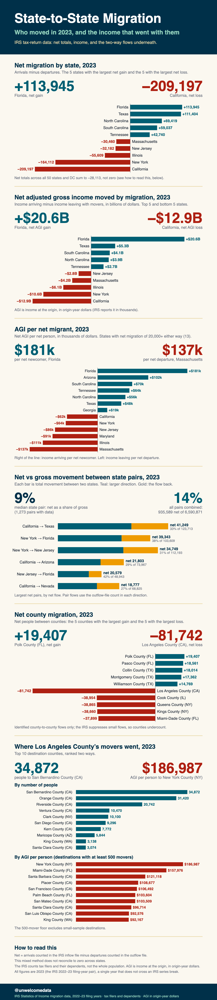
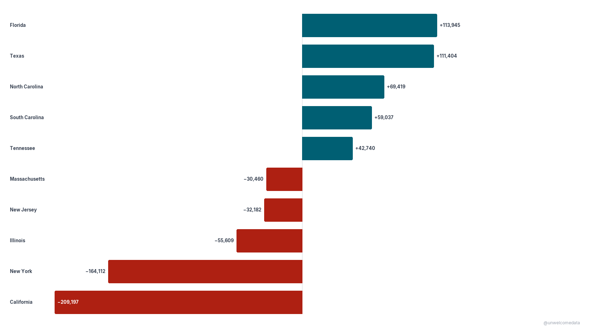
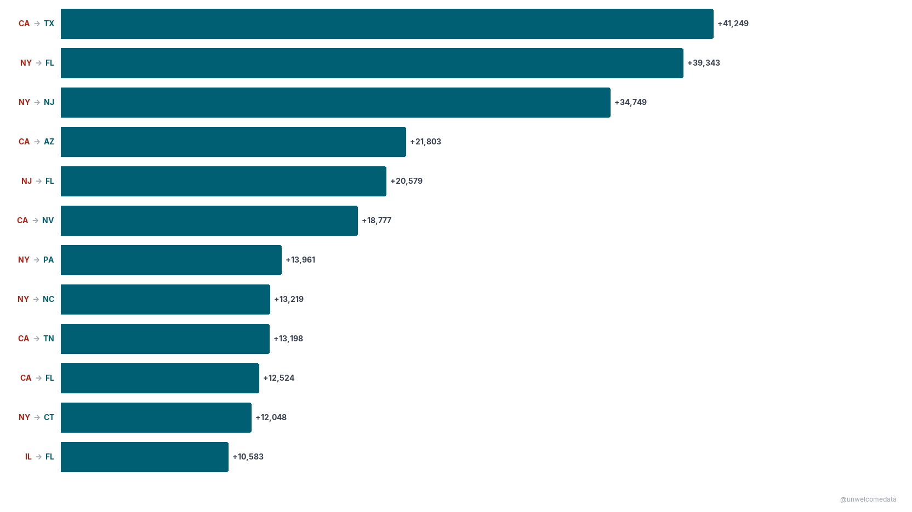
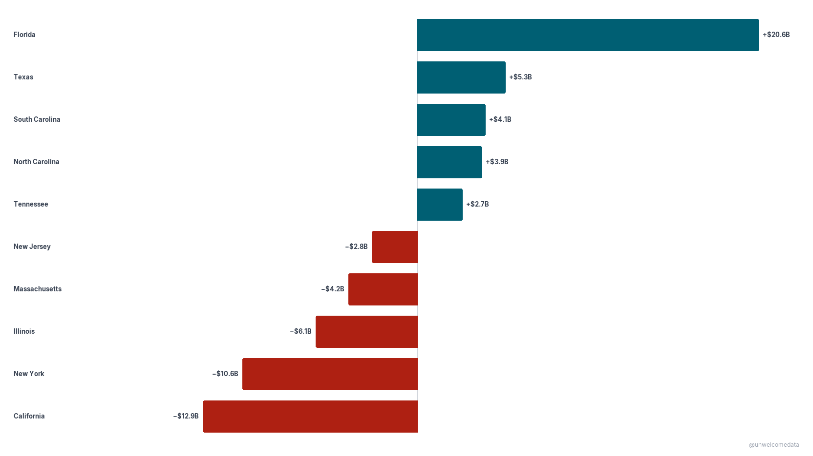
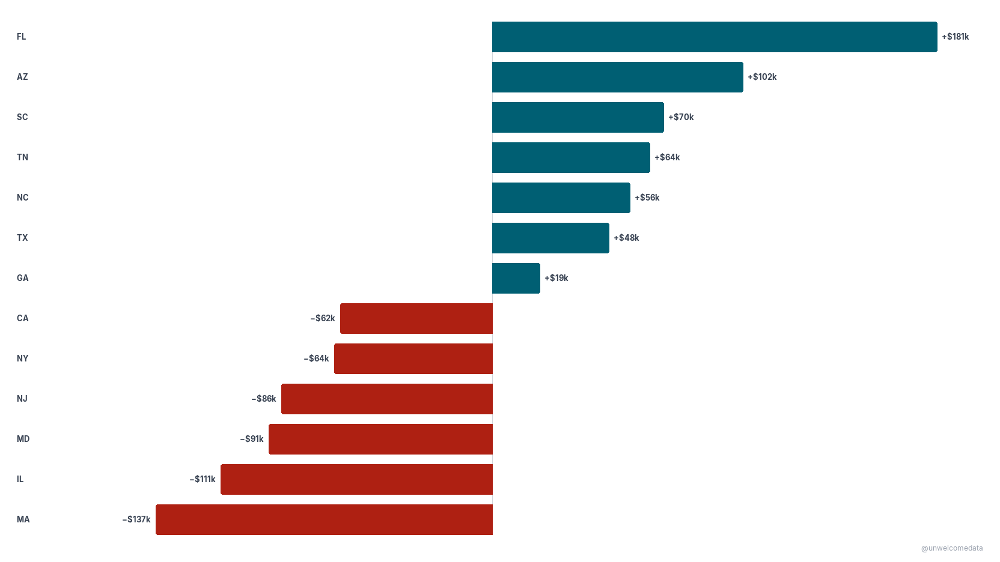
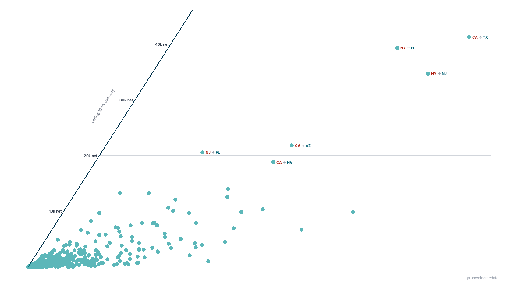
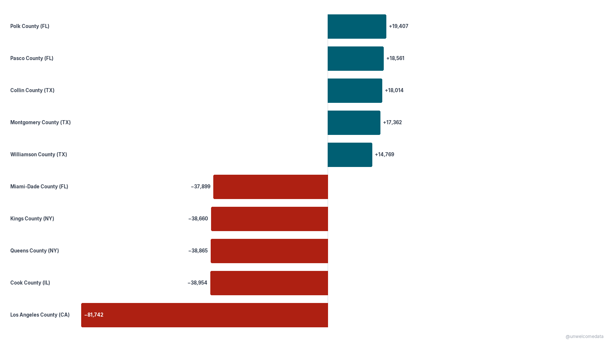
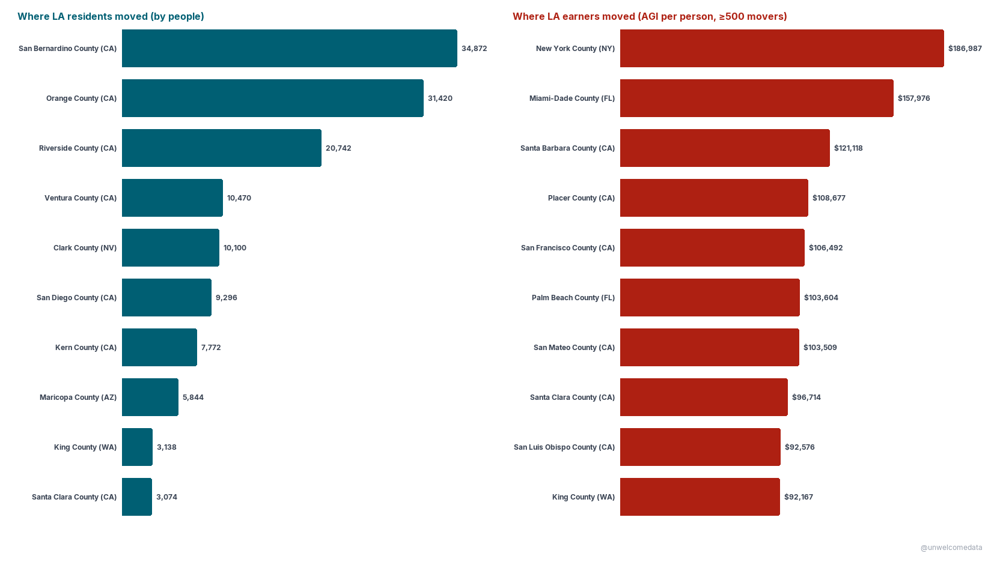

**[@unwelcomedata](https://github.com/unwelcomedata)** · data from public sources

# Where Americans moved between states — and the income that moved with them

State-to-state migration for 2023, measured two ways at once: **who** moved
(Census ACS survey, people-weighted) and **how much income** moved with them (IRS
tax-return data, income-weighted). Putting both next to each other is the point —
they answer different questions and shouldn't be blended into one number.

[](docs/infographic_state_migration.png)

---

**The findings that held up:**

- **Florida and Texas gained the most people; California and New York lost the
  most.** Florida also gained the most *income*, on the order of +$20 billion in
  adjusted gross income for the year; California and New York each shed north of
  $10 billion.
- **Most interstate movement cancels out.** Roughly nine out of ten moves between
  states are offset by moves in the opposite direction — the median state's *net*
  migration is only about 9% of its *gross* churn. The headline "net" numbers ride
  on top of a much larger two-way flow.
- **The income a state gains per net migrant varies enormously.** Florida gained
  roughly $181,000 of AGI per net migrant (high earners moving in); some states
  lost well over $100,000 per net departure.

---

## The charts

_All figures are for **2023**, from IRS tax-return data. "Net" = inflow-file
arrivals minus outflow-file departures. Click any chart to open it full size._

**The 5 states gaining the most people — and the 5 losing the most.** Net
migration in 2023 (arrivals minus departures), trimmed to the 10 extremes.

[](docs/01_net_migration_by_state.png)

**The biggest one-way moves between states, 2023.** The largest *net* directed
pairs — the red state lost people to the blue state.

[](docs/02_biggest_one_way_moves.png)

**The states gaining — and losing — the most income to migration.** Net adjusted
gross income moved with migrants in 2023, in **billions of dollars** (IRS AGI,
origin-year dollars).

[](docs/03_net_income_by_state.png)

**The average income of the people each state gains and loses.** Net AGI per net
migrant in 2023, in **thousands of dollars per person** — right: income arriving
per net newcomer; left: income leaving per net departure. States with net
migration of at least 20,000 people.

[](docs/04_income_per_migrant.png)

**Most interstate moves cancel each other out.** Each dot is a state pair, net
migration against gross (total) churn. A pair can never have more net than total
migration, so the diagonal is a ceiling almost no pair reaches.

[](docs/05_net_vs_gross.png)

### Down to the county

The same IRS tax-return data also tracks moves **county-to-county**. These two
charts are **2023**, use IRS **county-to-county identified flows only** (small
flows are suppressed by the IRS, so counties undercount by design), and net =
inflow-file arrivals minus outflow-file departures.

**County migration — the biggest gainers and losers.** Net moves of people
between counties in 2023 (top 5 gaining counties, bottom 5 losing). The counties
losing the most are big urban cores — **Los Angeles (−81,742)**, Cook/Chicago,
Queens, Kings/Brooklyn, Miami-Dade — and the ones gaining the most are sunbelt
suburbs in Florida and Texas (Polk, Pasco, Collin, Montgomery, Williamson).

[](docs/06_county_net_migration.png)

**Los Angeles County's two migrations.** LA is the biggest single loser, so it
gets a closer look — the top 10 destination counties, two ways. **Left: by number
of people** — the volume goes to LA's own cheaper inland ring (San Bernardino
34,872, Orange, Riverside). **Right: by AGI per person** (limited to destinations
with at least 500 movers, to exclude tiny-sample resort counties) — the highest
earners leave for other elite metros (Manhattan ≈ $186,987 of AGI per person,
Miami-Dade, Santa Barbara, San Francisco). The headcount and the money go to
different places.

[](docs/07_la_county_detail.png)

---

## How it was measured

Two federal sources, kept side by side rather than merged:

- **IRS Statistics of Income (SOI)** — built from *tax returns*. A change of state
  between two filing years counts as a move. It's income-weighted (it carries AGI)
  but its universe is **tax filers and their dependents**, not everyone.
- **Census ACS** — a *survey* ("where did you live one year ago?"). It's
  people-weighted and captures everyone regardless of tax status, but every
  estimate carries a margin of error, and small flows are unreliable.

The two correlate strongly (Pearson r ≈ 0.86) but measure different universes, so
the dataset reports both columns and never reconciles them to a single figure.

**Caveats that materially affect interpretation:**

- **"Net" here uses the IRS convention** (arrivals from the inflow file minus
  departures from the outflow file). It's the more legible story, but it doesn't
  reconcile to exactly zero across all states (a residual on the order of tens of
  thousands, from a few one-sided edges). Stated plainly so the totals aren't
  over-read.
- **IRS counts filers + dependents, not total population**, and its AGI is income
  *at the origin*, in that year's thousands of dollars — it's not the mover's later
  earnings.
- **The published data spans 2011–2024**, but this release's story is the **2023**
  single year. IRS has methodology **series breaks at 2011–12 and 2022–23**, and
  ACS **has no 2020 release** and a known **2022 Connecticut** error — so any
  multi-year comparison must carry those caveats. 2023 alone crosses none of them.
- **The county charts are a single-year (2023) snapshot of identified flows.**
  IRS suppresses small county-to-county flows, so the identified edges undercount
  real movement (nationally they capture a majority of it, not all), and a
  county's "net" is the sum of its identified edges only. The county income class
  used elsewhere in the data describes the *place* (a county's resident
  AGI-per-return vs the national median), **not** the income of the individual
  movers.

Per-source collection methods, definitions, series breaks, and the full column
glossary are in [SOURCES.md](SOURCES.md).

---

## The data

The published dataset is in [`export/`](export/):

- `state_migration_flows_v1.csv` — directed state-to-state flows with both the IRS
  (returns, individuals, AGI in/out) and ACS (migrants, margin of error) measures
  side by side, 2011–2024.
- `state_migration_flows_v1_codebook.md` — a plain-English description of every
  column.
- `county_migration_flows_v1.csv` — directed **county-to-county** flows for 2023,
  each endpoint tagged with its income class (above/below the national median
  county AGI-per-return), with the IRS returns / individuals / AGI measures. This
  is the data behind the two county charts above.
- `county_migration_flows_v1_codebook.md` — a plain-English description of every
  county column.

The richer packaging (Excel, Parquet) and the full pipeline code are in the repo.

---

## Reproduce it

The published dataset rebuilds from raw sources with one command:

```bash
python scripts/reproduce.py
```

It runs the full pipeline — **ingest → load → clean → prepare** — using the same
logic the project uses throughout (in [`src/`](src/): `ingest.py`,
`clean_quality.py`, `prepare.py`). On the first run it downloads the IRS SOI state
CSVs and the Census ACS migration tables (the URLs are in [SOURCES.md](SOURCES.md))
into `data/raw/`; after that it runs offline. The output CSV is byte-for-byte
identical to the published `export/state_migration_flows_v1.csv`. See
[`scripts/README.md`](scripts/README.md) for options and the stage-by-stage
breakdown.

For exploring the built database directly, [`queries/example_queries.sql`](queries/example_queries.sql)
has read-only reference queries (table list, provenance, top net gainers/losers,
income-per-migrant).

*(This reproduces the state-level flows dataset. The county-to-county layer is
built through the same `src/` pipeline from the IRS county files; the published
`county_migration_flows_v1.csv` is included in [`export/`](export/).)*

---

## Sources & license

Full attribution — publisher, URL, collection method, definitions, series breaks,
and known controversies — is in [SOURCES.md](SOURCES.md). In short: IRS Statistics
of Income migration data and U.S. Census Bureau ACS state-to-state migration flows,
both U.S. government works in the public domain. No crowd-edited sources are used.

---

## Further exploration

- A **multi-year time series** (2011–2024) of net migration, carrying the IRS and
  ACS series-break caveats — does the Florida/Texas trend accelerate, and where's
  the COVID bump?
- **Stayers vs. leavers income**: do the people leaving a state earn more or less
  than those who stay?
- A **wider county cut** — the two county charts here are a single 2023 snapshot
  for a handful of counties; a multi-county, multi-year county view (metro-level
  rollups, the affordability-migration pattern over time) is the natural next step.

---

> **AI-Assisted Development**
> This project was built with the assistance of [Kiro](https://kiro.dev), an
> AI-powered development environment. All data-sourcing decisions, methodology
> choices, and published findings are the responsibility of the author. AI was
> used for code generation, data-pipeline construction, and research assistance —
> not for analysis conclusions or editorial judgment.
